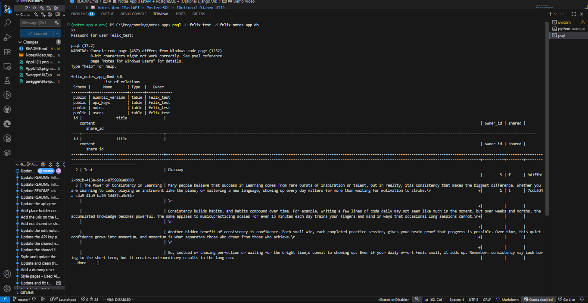

# Notes App

A note-taking application where users can create, store, edit and share notes securely.

- **Backend:** FastAPI + PostgreSQL (JWT authentication, SQLAlchemy, Alembic migrations)
- **Frontend (optional):** a lightweight Django UI that consumes the FastAPI backend
- **API docs:** Swagger UI and ReDoc, protected by an API key

You can use the app through the Django UI, or talk to the API directly.

[Postman Documentation](https://documenter.getpostman.com/view/48823076/2sB3QDvD8B) | [Demo Video](https://drive.google.com/file/d/1JnpweAYKAhdrxTlIZothezO-PejCnUr2/view?usp=sharing) | [Repository](https://github.com/felixmokayabeatz/notes_app)

---

## Table of Contents

1. [Features](#features)
2. [Tech Stack](#tech-stack)
3. [Prerequisites](#prerequisites)
4. [Installation](#installation)
5. [Environment Variables](#environment-variables)
6. [Database Setup](#database-setup)
7. [Running the App](#running-the-app)
8. [API Overview](#api-overview)
9. [Django UI Pages](#django-ui-pages)
10. [Screenshots](#screenshots)
11. [Troubleshooting](#troubleshooting)

---

## Features

- JWT authentication (register, login, current user)
- Notes CRUD (create, read, update)
- Share notes through a share link
- Forgot password and reset password flow
- API key generation to access the Swagger and ReDoc docs
- Optional Django UI with a landing page, forms and note pages
- PostgreSQL for persistence, Alembic for migrations

## Tech Stack

| Part | Technology |
| --- | --- |
| API | [FastAPI](https://fastapi.tiangolo.com/), [Uvicorn](https://www.uvicorn.org/) |
| Database | [PostgreSQL](https://www.postgresql.org/), [SQLAlchemy](https://www.sqlalchemy.org/), [Alembic](https://alembic.sqlalchemy.org/) |
| Frontend (optional) | [Django](https://www.djangoproject.com/) |
| Django to FastAPI calls | [Requests](https://docs.python-requests.org/) |

## Prerequisites

- Python 3.10 or newer
- PostgreSQL (download from the [official website](https://www.postgresql.org/download/))
- Git

## Installation

### 1. Clone the repository

```bash
git clone https://github.com/felixmokayabeatz/notes_app.git
cd notes_app
```

### 2. Create and activate a virtual environment

Linux/macOS:

```bash
python3 -m venv notes_app_v_env
source notes_app_v_env/bin/activate
```

Windows:

```bash
python -m venv notes_app_v_env
notes_app_v_env\Scripts\activate
```

### 3. Install dependencies

```bash
pip install -r requirements.txt
```

### 4. Create your `.env` file

Linux/macOS:

```bash
cp .env.example .env
```

Windows PowerShell:

```powershell
Copy-Item .env.example .env
```

Never commit your `.env` file. It is already listed in [`.gitignore`](.gitignore). Use [`.env.example`](.env.example) as the safe template to share.

## Environment Variables

The app reads these from the `.env` file in the project root.

| Variable | Description | Example |
| --- | --- | --- |
| `DB_USER` | PostgreSQL user | `felix_test` |
| `DB_PASSWORD` | PostgreSQL password | `choose-a-strong-password` |
| `DB_HOST` | PostgreSQL host | `localhost` |
| `DB_PORT_POSTGRESQL` | PostgreSQL port | `5432` |
| `DB_NAME` | Database used by FastAPI | `felix_notes_app_db` |
| `DJANGO_DB_NAME` | Database used by Django | `felix_notes_app_db_django` |
| `DJANGO_SECRET_KEY` | Django secret key | a long random string |
| `DEBUG` | Django debug mode | `True` |
| `ALLOWED_HOSTS` | Comma-separated Django hosts | `localhost,127.0.0.1` |
| `ADMIN_SECRET` | FastAPI admin secret | a strong secret |

## Database Setup

Create one user and two databases: one for FastAPI and one for Django.

### Option A: terminal

```bash
# Use the default superuser, or another one if you set it up
psql -U postgres
```

```sql
-- Use your own password, and put the same one in .env
CREATE USER felix_test WITH PASSWORD 'choose-a-strong-password';

CREATE DATABASE felix_notes_app_db OWNER felix_test;         -- FastAPI
CREATE DATABASE felix_notes_app_db_django OWNER felix_test;  -- Django

GRANT ALL PRIVILEGES ON DATABASE felix_notes_app_db TO felix_test;
GRANT ALL PRIVILEGES ON DATABASE felix_notes_app_db_django TO felix_test;

\q
```

### Option B: pgAdmin

Download [pgAdmin](https://www.pgadmin.org/download/) and create the same user and databases through the GUI. This is easier if you are new to PostgreSQL on the terminal.

### Apply migrations

FastAPI (Alembic). The migrations folder is already in the repository and reads the database settings from your `.env`, so you do not need to edit `alembic.ini`:

```bash
alembic upgrade head
```

Only if you change the models and need a new migration:

```bash
alembic revision --autogenerate -m "describe your change"
alembic upgrade head
```

Django:

```bash
cd notes_ui
python manage.py migrate
```

## Running the App

Run FastAPI and Django in **separate terminals at the same time**, on different ports.

### Terminal 1: FastAPI backend

From the project root:

```bash
uvicorn app.main:app --reload
```

The API runs at http://127.0.0.1:8000

### Terminal 2 (optional): Django frontend

```bash
cd notes_ui
python manage.py runserver 8001
```

The UI runs at http://127.0.0.1:8001 and the login page is at http://127.0.0.1:8001/login/

The Django UI calls the API at `http://127.0.0.1:8000`, so keep FastAPI running while you use it.

### Accessing the API docs

The docs routes (`/docs`, `/redoc`, `/openapi.json`) require an API key sent in the `X-API-Key` header.

1. With FastAPI running, generate a key from the Django UI at http://127.0.0.1:8001/api-key/ or with `POST http://127.0.0.1:8000/generate-api-key`.
2. Send the key in the `X-API-Key` header when opening the docs. A browser needs an extension that adds request headers for this, or you can use a tool such as curl or Postman.

```bash
curl -H "X-API-Key: YOUR_KEY" http://127.0.0.1:8000/openapi.json
```

## API Overview

| Method | Endpoint | Description |
| --- | --- | --- |
| GET | `/` | Welcome message |
| POST | `/generate-api-key` | Generate an API key |
| POST | `/users/register` | Register a user |
| POST | `/users/login` | Log in and receive a JWT |
| GET | `/users/me` | Current user |
| POST | `/users/forgot-password` | Start a password reset |
| POST | `/users/reset-password` | Complete a password reset |
| POST | `/notes/` | Create a note |
| GET | `/notes/` | List your notes |
| GET | `/notes/{note_id}` | Get one note |
| PUT | `/notes/{note_id}` | Update a note |
| GET | `/notes/shared/{share_id}` | View a shared note |

Full request and response examples are in the [Postman documentation](https://documenter.getpostman.com/view/48823076/2sB3QDvD8B).

## Django UI Pages

| URL | Page |
| --- | --- |
| `/` | Landing page |
| `/register/` | Register |
| `/login/` | Login |
| `/notes/` | Your notes |
| `/notes/new/` | Create a note |
| `/notes/<id>/edit/` | Edit a note |
| `/notes/<id>/share/` | Share link for a note |
| `/notes/shared/<share_id>/` | View a shared note |
| `/api-key/` | Generate an API key |
| `/forgot-password/` | Request a password reset |
| `/reset-password/` | Reset your password |

## Screenshots

### Swagger UI


### Frontend


### Database and tables




## Demo

[Watch the demo](https://drive.google.com/file/d/1JnpweAYKAhdrxTlIZothezO-PejCnUr2/view?usp=sharing)

## Troubleshooting

- **Django pages have no styling:** make sure you start Django from inside the `notes_ui` folder and that `DEBUG=True` in `.env`. Stylesheets are served from `core/static/core/css/`.
- **Connection errors from the UI:** FastAPI must be running on port 8000 and Django on port 8001, each in its own terminal.
- **Database connection errors:** check that the values in `.env` match the PostgreSQL user and databases you created, and that PostgreSQL is running.
- **`/docs` returns 403:** you need a valid key in the `X-API-Key` header (see [Accessing the API docs](#accessing-the-api-docs)).
- **Password reset emails are not sent:** the mail settings in `app/note_app_routers/users.py` are placeholders. Replace them with your own SMTP details.
